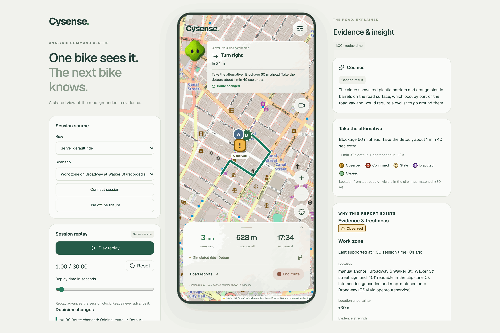
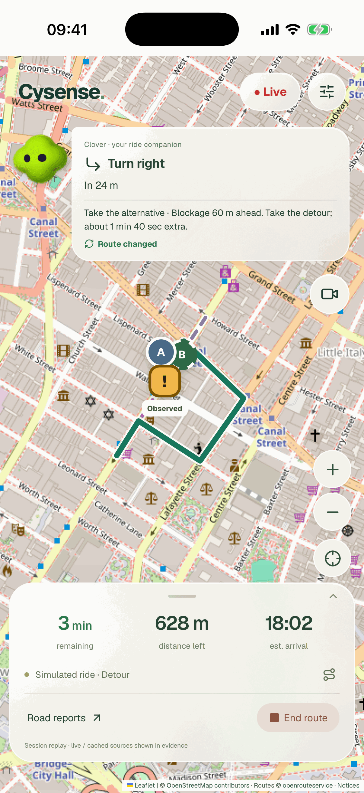
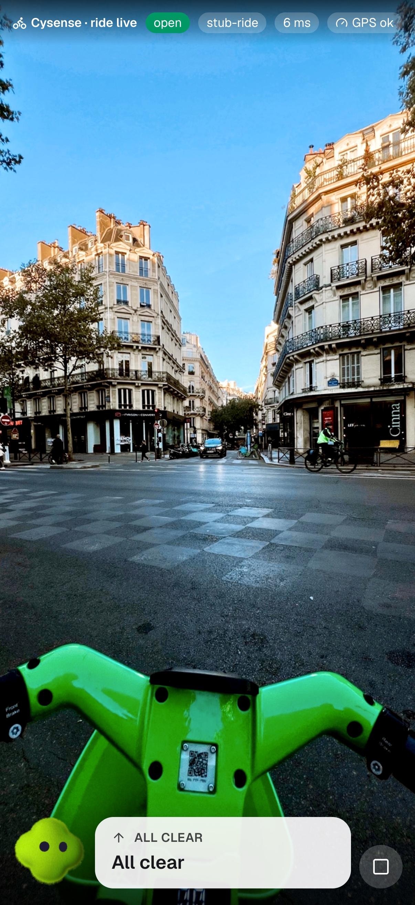
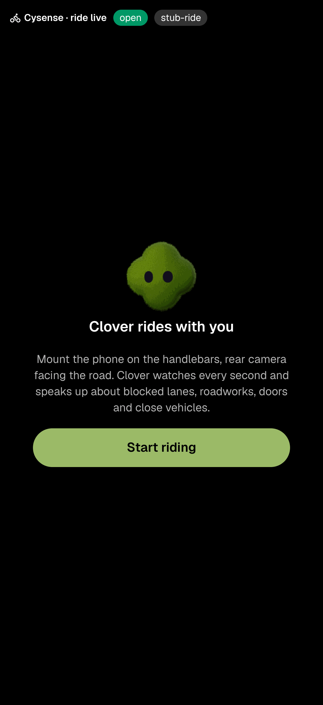
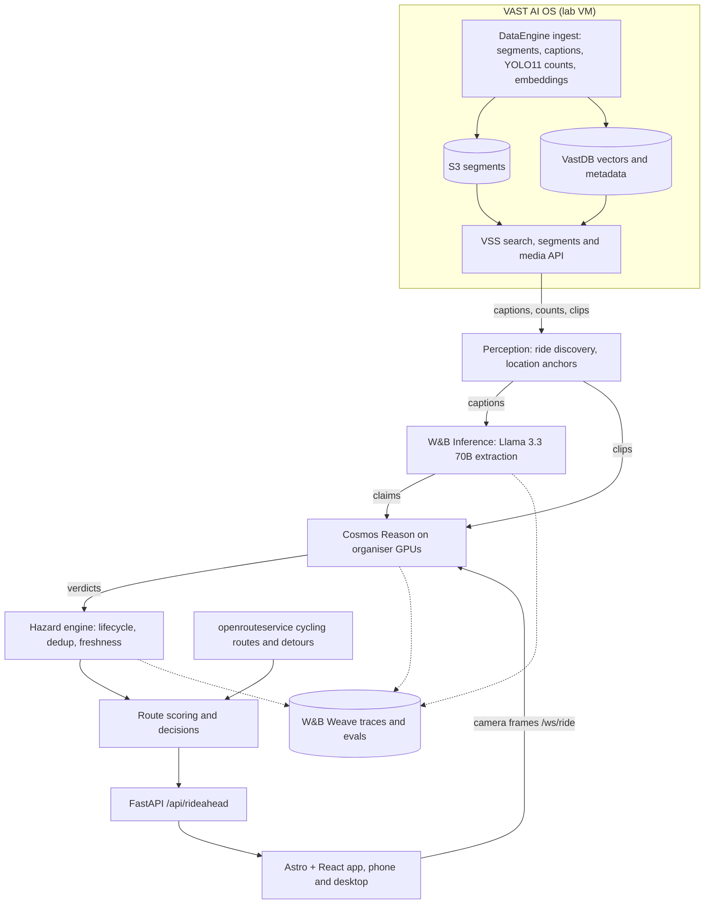

# Cysense

**One bike sees it. The next bike avoids it.**

Cysense turns street video into shared, evidence-linked road reports for cyclists. When one
camera sees a blocked bike lane or a work zone, that observation becomes a hazard report with
its clip, its model check, its location uncertainty and its age. A second rider heading the same
way then gets a decision that fits their route and arrival time: carry on, slow down, wait, or
take a real detour.

Built in one day at the **VAST Builders Challenge London: Real-Time Video Agents Hack**
(17 October 2026, team-46), on VAST AI OS, NVIDIA Cosmos and Weights & Biases.



<table>
  <tr>
    <td align="center" width="33%"></td>
    <td align="center" width="33%"></td>
    <td align="center" width="33%"></td>
  </tr>
  <tr>
    <td align="center"><b>Map navigation</b><br><sub>Replay demo on an iPhone 17 Pro simulator</sub></td>
    <td align="center"><b>Live ride camera</b><br><sub><code>/ride</code>: rear camera, with Clover watching</sub></td>
    <td align="center"><b>Before the ride</b><br><sub>The camera starts only after a tap</sub></td>
  </tr>
</table>

> **About these screenshots.** They were taken on 18 October 2026 from a local build, after the
> event. The organisers' lab VM, with the video archive and the GPU endpoints, has since been shut
> down, so:
>
> - The recorded clips can no longer stream. The phone's road-view panel is minimised and the
>   desktop "Ride camera" card is hidden, rather than showing a dead player.
> - Routes, observations and the Cosmos text are the real outputs recorded on the day, replayed
>   from [`server/fixtures/rideahead`](server/fixtures/rideahead).
> - The iOS Simulator has no camera, so the two camera shots come from headless Chromium at
>   iPhone 17 Pro size, with a royalty-free [Pexels photo](https://www.pexels.com/photo/34732250/)
>   as the camera feed. With no GPU, `/ride` falls back to the offline `stub-ride` analyser, so
>   its "All clear" is not a model output. On the day, each frame went to Cosmos Reason.

## What it does

1. **Find evidence in the archive.** The event's pre-indexed street and cycling footage lives
   on VAST AI OS. We pull a ride's segments and captions through the VSS API.
2. **Extract, then verify.** W&B Inference (Llama 3.3 70B) turns each caption into a structured
   claim, such as "vehicle blocking the bike lane". Cosmos Reason then watches the clip itself
   and returns `supported`, `contradicted` or `unclear`. A caption alone never becomes a hazard.
3. **Place it on the map.** No usable GPS was available, so locations come from street signs
   and storefronts readable in the footage. Each one carries its uncertainty (±30–150 m).
4. **Keep it alive or let it fade.** The hazard engine dedups reports and tracks their state:
   `observed → confirmed → stale → cleared` (or `disputed`). Stale never counts as cleared. A
   repeat sighting from the same camera counts as persistence, not as independent confirmation.
5. **Decide for the next rider.** The route scorer checks whether the hazard is on the
   approaching rider's route, in their direction, and still fresh when they arrive. It asks
   openrouteservice for a real bicycle detour (`avoid_polygons`) and chooses between *continue*,
   *heads up*, *slow down*, *wait* and *take the alternative*.
6. **Talk to the rider.** Clover, the ride companion, gives turn-by-turn directions and explains
   every route change. In live mode it also reads the rear camera and speaks warnings.

Every model call is a `@weave.op`, so the whole chain shows up in Weave. The lifecycle
evaluation (21 of 21 scenarios passing) is published there as a Weave Evaluation.

### What the real data showed

We report what happened, including what didn't work:

- **Broadway & Walker St work zone (real).** Two clips from the same fixed street camera, about
  half an hour apart. Cosmos supported the obstruction on both ("red plastic barriers and orange
  plastic barrels on the road surface… would require a cyclist to go around them"). A street
  sign and a building number in the clip pinned the location to ±30 m. This scenario drives the
  desktop screenshot above.
- **6th Avenue bike ride (trust layer).** Five caption claims of a blocked bike lane were checked
  by Cosmos against the clips. Three came back `contradicted` (the vehicle was beside the green
  lane, and the lane was clear) and two stayed uncertain. So the real ride footage produced no
  hazard, and the demo obstruction on that route is a clearly labelled synthetic event.
- **No accident footage** turned up in the archive, so collision prediction and TTC were left out
  on purpose.

## Ways to use it

| Route | What it is |
|---|---|
| `/` | Replay demo. Desktop shows the analysis command centre around a phone view. A phone gets the full-screen map navigation. |
| `/?mode=live` | Live navigation: your GPS, destination search (Nominatim), an OSRM bike route, then the rear camera → Cosmos → Clover warnings, with rerouting around blocked paths. |
| `/ride` | Full-screen handlebar camera. Each second a frame goes to Cosmos, and Clover speaks hazards (blocked lane, roadworks, doors, close vehicles, surface). |
| `/?preview=1` | Offline canonical replay: observed → stale → cleared, no server session needed. |
| `/live` | The original live camera diagnostics and upstream status. |

## Architecture



- **One origin.** FastAPI serves the static Astro build plus `/api` and `/ws` from the lab VM.
  A Cloudflare named tunnel published it at `cysense.elio.ltd`. VSS, S3 and VastDB were only
  reachable inside VAST's network, so the server had to live there.
- **Provenance everywhere.** The UI labels every item as recorded footage, a cached model
  output, a reconstructed location or a synthetic scenario event. A cached result never claims
  to be live inference.
- **Contracts first.** FastAPI's OpenAPI schema generates the browser types (`make gen-api`).
  The canonical RideAhead models live in `server/app/agent/models.py`.

More detail: [docs/architecture.md](docs/architecture.md) and
[master-prompt.md](master-prompt.md) (the spec the four coding agents built from).

## Tools, resources and services

### Sponsor platforms

| Service | What we used it for |
|---|---|
| **VAST Data AI OS** | Lab VM; the DataEngine ingest pipeline that segments, captions, runs detection on and embeds the footage; S3 buckets for chunks and segments; VastDB for the vectors and metadata behind search (plus a direct `vastdb` SDK client); the VSS API for search, segments, captions, detections and media streaming |
| **NVIDIA Cosmos Reason** (`nvidia/cosmos3-nano-reasoner`) | Verifying caption claims against the video clip; reading hazards from live handlebar-camera frames |
| **YOLO11** | Object counts per segment, produced by the VSS ingest pipeline and kept as evidence with each observation. The app reads them from the archive and doesn't call the YOLO endpoint itself |
| **NVIDIA Cosmos Embed1**, **Canary-1B** | Wired into the GPU client and the upstream health probe, but not used by the final demo |
| **W&B Inference** (`meta-llama/Llama-3.3-70B-Instruct`, OpenAI-compatible) | Structured observation extraction from VSS captions |
| **W&B Weave** | Traces of every model call and hazard transition; Weave Evaluation of the hazard lifecycle |

The Cosmos, YOLO11 and Canary models ran on GPU endpoints that the organisers provided for the
event.

### Maps, routing and geodata

| Service | Use |
|---|---|
| [openrouteservice](https://openrouteservice.org) (`cycling-regular`) | Bicycle routes, alternatives and hazard-avoiding detours. Genuine responses are recorded in [`routes_ors_cache.json`](server/fixtures/rideahead/routes_ors_cache.json) and replayed when no key is set |
| [OSRM bike profile](https://routing.openstreetmap.de) (FOSSGIS) | Routing in live mode |
| [Nominatim](https://nominatim.openstreetmap.org) | Destination search in live mode |
| [OpenStreetMap](https://www.openstreetmap.org/copyright) tiles + [Leaflet 1.9.4](https://leafletjs.com) | Street map, route lines, rider and hazard markers |

### App stack

| Layer | Tech |
|---|---|
| Web | Astro 6 (static) with React 19 islands, Tailwind CSS 4, shadcn/ui on Radix, Lucide icons, Geist font, sonner, openapi-fetch + openapi-typescript, [bot-avatars](https://libraries.dev) (Clover) |
| Browser APIs | getUserMedia (rear camera), Geolocation, Web Speech synthesis (spoken warnings), Vibration, Screen Wake Lock, WebSocket |
| Server | Python 3.12, FastAPI, Pydantic + pydantic-settings, httpx, OpenAI SDK (for W&B Inference), weave, uvicorn, uv |
| Quality | ruff, pyright, pytest · Prettier, ESLint, `astro check`, Vitest, TypeScript · GitHub Actions running `make verify` on every push and PR · Dependabot |
| Hosting | Organiser lab VM, tmux, Cloudflare named tunnel and DNS (`cysense.elio.ltd`) |

### How we built it

Four people, each driving an AI coding agent (two on Claude Code, two on OpenAI Codex), worked
in parallel lanes: A integration and runtime, B interface, C archive and perception, D hazard
engine and evaluation. Each lane owned its files, and the lanes reported through handoff notes.
The coordination docs are part of the repo:

- [AGENTS.md](AGENTS.md): rules for every coding agent ([CLAUDE.md](CLAUDE.md) just includes it)
- [COLLABORATION.md](COLLABORATION.md): lanes, file ownership, git rhythm
- [master-prompt.md](master-prompt.md): the RideAhead build spec and evidence rules
- [docs/rideahead/](docs/rideahead): handoffs [A](docs/rideahead/handoff-A.md),
  [B](docs/rideahead/handoff-B.md), [C](docs/rideahead/handoff-C.md),
  [D](docs/rideahead/handoff-D.md), the [hazard catalogue](docs/rideahead/hazard-catalogue-c.md),
  [design notes](docs/rideahead/design-notes-rishik.md), the
  [deploy runbook](docs/rideahead/deploy-runbook.md) and an
  [interface review](docs/rideahead/interface-map-review/verification.md)
- [server/eval/README.md](server/eval/README.md): how to rerun the evaluation

"RideAhead" was the working name during the build, and it survives in API paths and module
names. "Cysense" is the product name.

## Run it locally

Requires [uv](https://docs.astral.sh/uv/), Node 22 and pnpm.

```bash
make setup                           # pnpm install + uv sync
cp server/.env.example server/.env   # optional: ORS_API_KEY, WANDB_* for live calls
make dev                             # API on :8000, web on :4321
```

Open http://localhost:4321. With no upstreams configured, the server still runs the full replay:
recorded openrouteservice routes, cached Cosmos and W&B outputs, and the hazard engine. Live
camera modes fall back to stub analysers. Only the recorded footage needs the (now gone) VSS
archive.

| Command | What it does |
|---|---|
| `make dev` | API with reload on :8000, web dev server on :4321 (proxies `/api` and `/ws`) |
| `make verify` | ruff, pyright, pytest · prettier, eslint, astro check, vitest, build |
| `make gen-api` | Server OpenAPI → `web/src/lib/api/schema.d.ts`, plus fixture snapshots |
| `make serve` | Production-like single origin on :8000 |
| `make probe` | Which upstreams are reachable from this machine |
| `make phone-tunnel` | HTTPS quick tunnel for testing the camera on a phone |
| `make deploy VM=bc-<you>` | Build the web app, sync to the lab VM, restart |

To rerun the evaluation (from `server/`):

```bash
uv run python -m eval.run --output eval/reports/local.json
uv run python -m eval.run --model-cache fixtures/rideahead/cache/model_outputs_v2.json --output eval/reports/c-cache-comparison.json
```

## Repository map

```
web/                 Astro + React app (src/components/rideahead is the main UI)
server/app/agent/    hazard engine, route scoring, perception, routing, runtime, prompts
server/app/clients/  one client per upstream: vss, gpu (Cosmos, YOLO11, Canary), llm, vastdb
server/app/api/      FastAPI routes: rideahead, live and ride WebSockets, archive, clips
server/fixtures/     recorded routes, scenarios and cached model outputs (no footage)
server/eval/         labelling sheets, lifecycle scenarios, evaluation runner and reports
docs/                architecture, deploy, VSS API notes, lane handoffs, screenshots
scripts/             deploy.sh (laptop → VM), vm-run.sh (on the VM)
```

## Status

The hackathon is over. We didn't place, but we're proud of what four people and four agents
shipped in a day. The lab VM, the VSS archive and the GPU endpoints belonged to the organisers
and have been shut down. `cysense.elio.ltd` may go offline or become a static page. Everything
cached in this repo still runs locally, as shown above.

## Team

<table>
  <tr>
    <td align="center"><a href="https://github.com/eliohd"><br><b>Elio</b></a><br><sub>@eliohd</sub></td>
    <td align="center"><a href="https://github.com/R1shik123"><br><b>Rishik</b></a><br><sub>@R1shik123</sub></td>
    <td align="center"><a href="https://github.com/Infosuii"><br><b>Om</b></a><br><sub>@Infosuii</sub></td>
    <td align="center"><a href="https://github.com/ishanp765"><br><b>Ishan</b></a><br><sub>@ishanp765</sub></td>
  </tr>
</table>

Thanks to VAST Data, NVIDIA and Weights & Biases for the platform, models and compute, and to
the organisers and judges of the London challenge.

## Data and licences

- Code: [MIT](LICENSE).
- Footage: the event's pre-indexed corpus, used under the organisers' terms. No video is stored
  in this repo; fixtures keep only captions, model outputs, hashes and source IDs.
- Map data © OpenStreetMap contributors (ODbL). Leaflet (BSD-2-Clause), SafeRoute UI patterns
  (MIT) and bot-avatars (MIT): see [web/public/map-notices.txt](web/public/map-notices.txt).
- The street photo in the camera screenshot is from [Pexels](https://www.pexels.com/photo/34732250/),
  used under the Pexels licence.
